<div align="center">

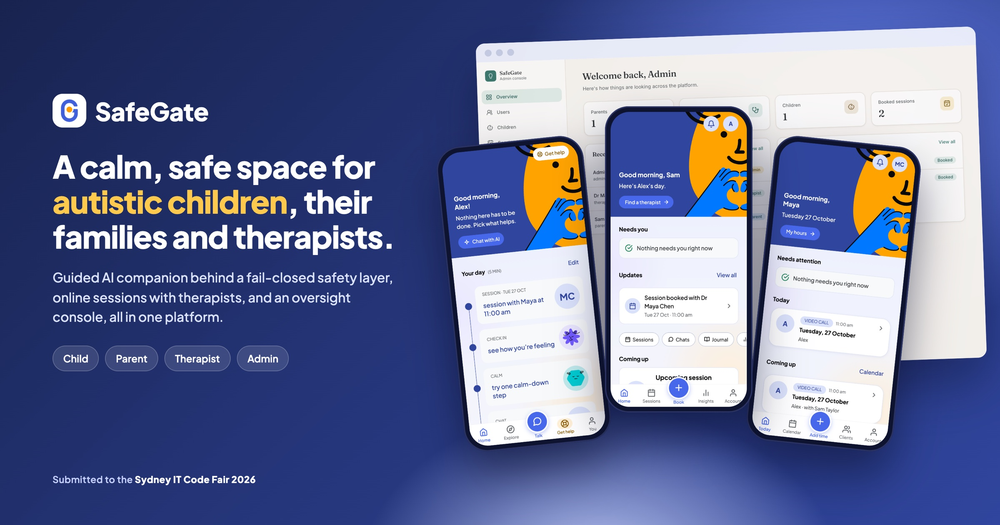

# SafeGate

**A calm, guided space for autistic children, their families and their therapists.**

A child talks to a guided AI companion that sits behind a fail-closed safety layer. Parents book
online sessions with therapists. An admin console keeps oversight without reading anyone's messages.

<p>


</p>

**Submitted to the Sydney IT Code Fair 2026**

[**▶ Watch the video demo**](#-video-demo) · [Screens](#-the-platform) · [Safety](#-safety-by-design) · [Architecture](#-architecture) · [Deployment](#-deployment) · [Team](#-team)

</div>

> [!IMPORTANT]
> **This is genuine and original work by Suyog Kadariya, Nasla Maharjan and Krish Rajbhandari.**
> The repository is public so it can be viewed and judged. It is **not** open source. No part of it
> may be copied, reused, modified, redistributed, deployed or submitted elsewhere without written
> permission from all three authors. See [`LICENSE`](LICENSE).

> [!NOTE]
> SafeGate is a prototype **support and learning tool**. It is not therapy, treatment, diagnosis,
> monitoring or an emergency service, and its safety text has not yet been reviewed by a clinician.
> In an emergency in Australia, call **000**.

---

## 🎬 Video demo

<!-- Replace the link below with the YouTube URL once the video is published. -->
**YouTube:** _coming soon_

---

## Contents

- [The problem](#-the-problem)
- [The platform](#-the-platform)
- [Safety by design](#-safety-by-design)
- [Privacy](#-privacy)
- [Architecture](#-architecture)
- [Deployment](#-deployment)
- [Tech stack](#-tech-stack)
- [Repository layout](#-repository-layout)
- [Running it locally](#-running-it-locally)
- [Testing](#-testing)
- [Project status](#-project-status)
- [Team](#-team)
- [Licence](#-licence)

---

## 💡 The problem

Autistic children often find it hard to name what they feel, and a meltdown or shutdown can arrive
before anyone notices the build-up. Families wait weeks between therapy sessions, and general-purpose
chatbots are not built for a child who needs short, literal and predictable language, or for the
moment when a child says something worrying.

SafeGate brings the three people who matter (the child, the parent and the therapist) into one
platform, built on one principle: **safety and privacy come before speed and features.**

---

## 📱 The platform

SafeGate is one mobile app with three sides (child, parent and therapist) plus a web console for
administrators.

<table>
  <tr>
    <td align="center" width="25%">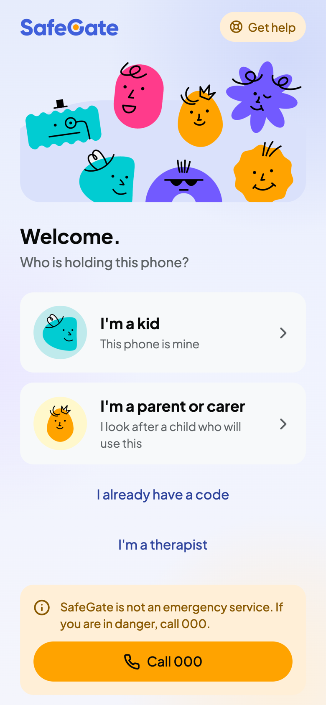<br><sub><b>Welcome</b><br>Who is holding this phone?</sub></td>
    <td align="center" width="25%">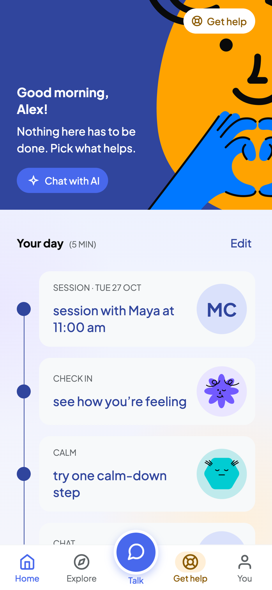<br><sub><b>Child · Home</b><br>A calm plan for the day</sub></td>
    <td align="center" width="25%">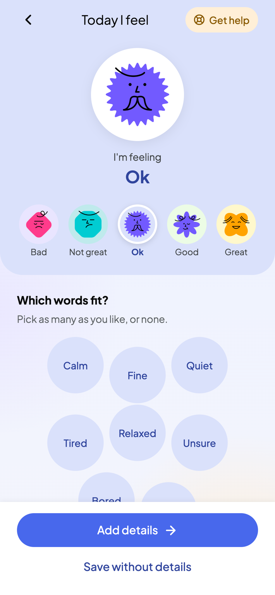<br><sub><b>Child · Check-in</b><br>Naming how they feel</sub></td>
    <td align="center" width="25%">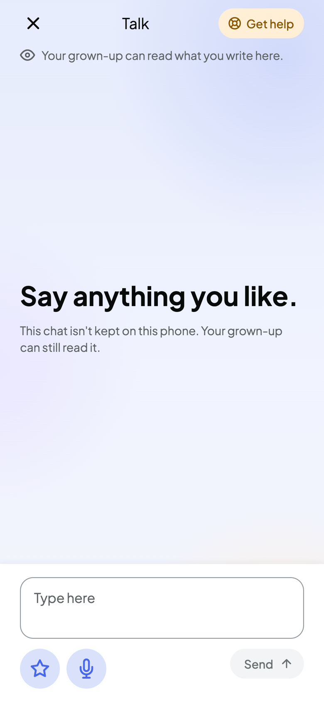<br><sub><b>Child · Talk</b><br>The guided AI companion</sub></td>
  </tr>
  <tr>
    <td align="center">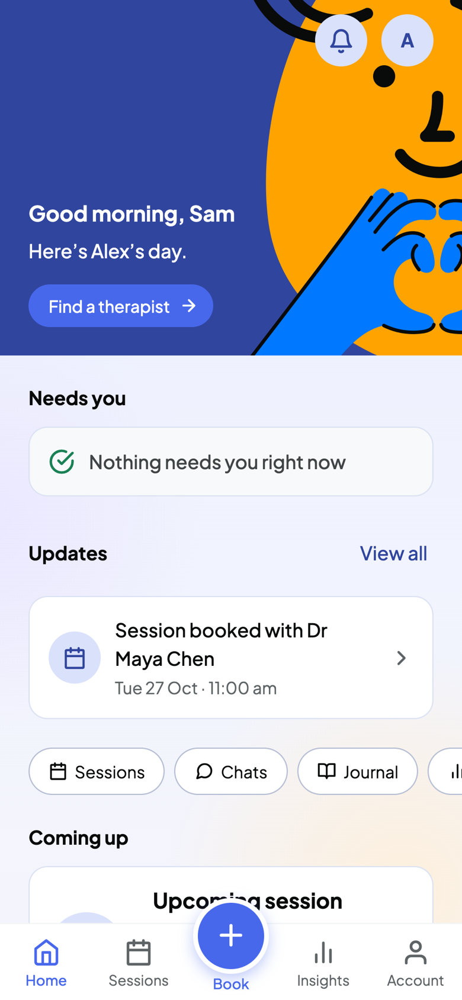<br><sub><b>Parent · Home</b><br>What needs them, and what is next</sub></td>
    <td align="center">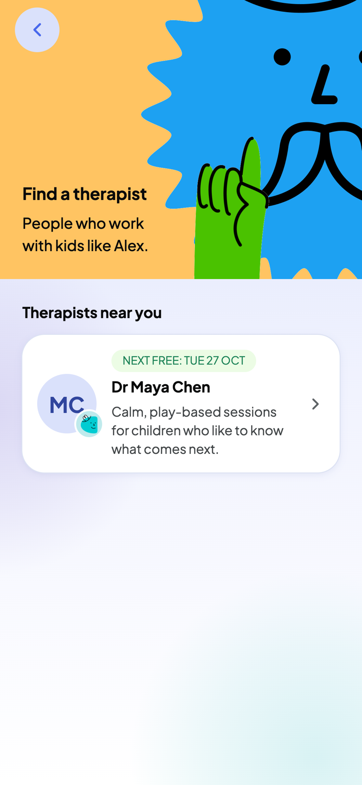<br><sub><b>Parent · Find a therapist</b><br>Practice details, never contact details</sub></td>
    <td align="center">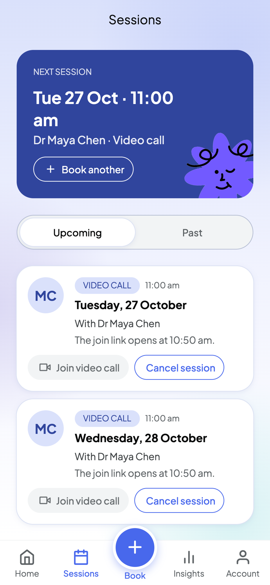<br><sub><b>Parent · Sessions</b><br>Book, join or cancel</sub></td>
    <td align="center">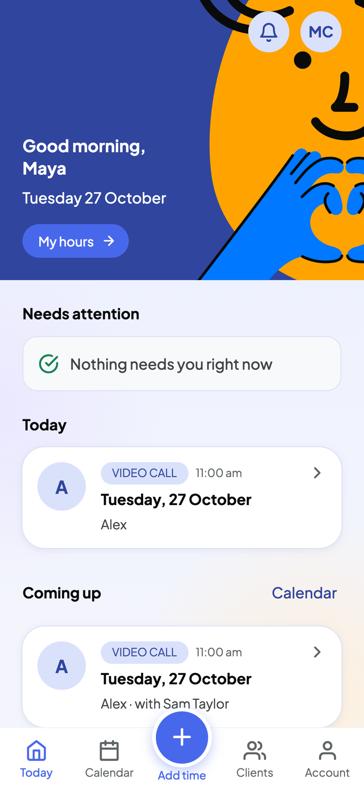<br><sub><b>Therapist · Today</b><br>Alerts and sessions first</sub></td>
  </tr>
</table>

<p align="center">
  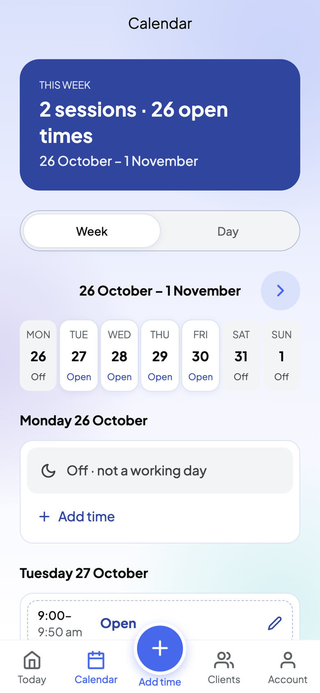
  &nbsp;&nbsp;
  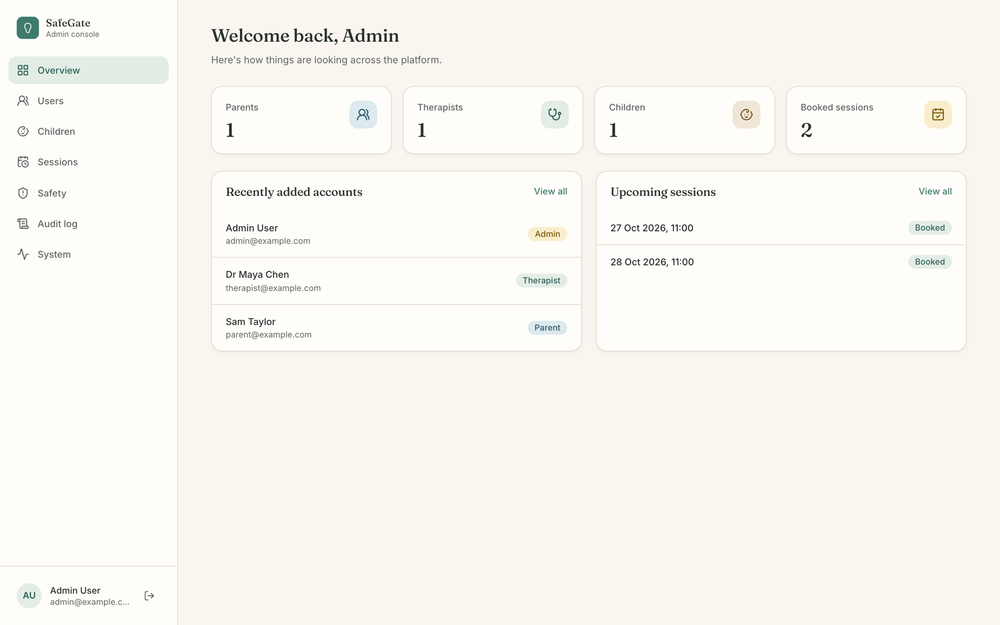
  <br><sub><b>Therapist · Calendar</b> (weekly hours become bookable times) &nbsp;·&nbsp; <b>Admin console</b> (oversight without message text)</sub>
</p>

<sub>All names and data in these screenshots are fictional demo data.</sub>

### What each person can do

| | |
|---|---|
| 🧒 **Child** | Talk to a guided companion that helps name emotions, walk through routines and try calming exercises. Type or speak (they check the transcript before it is sent). Daily check-ins, a journal, and their own session times. Reaches the app through a phone their parent links with a one-time code. A child never has an email or a password. |
| 👨‍👩‍👧 **Parent** | Link the child's phone, read the child's conversations, find and book a therapist, join video sessions, read the notes a therapist chooses to share, and respond to safety alerts with **"I've seen this"**. |
| 🧑‍⚕️ **Therapist** | Today's sessions and alerts about their own clients, weekly hours that turn into bookable times, client goals, and session notes in **two parts**: private working notes, and a part that is shared with the family only when the therapist chooses. |
| 🛡️ **Admin** | Verify therapists, manage accounts, work through the alerts inbox, review audit logs and change platform settings live. Admins see **metadata only**: never a child's messages, and never a seat in a live session. |

---

## 🚦 Safety by design

Every message a child sends goes through the same defence layer, in the same order, with no way
around it:

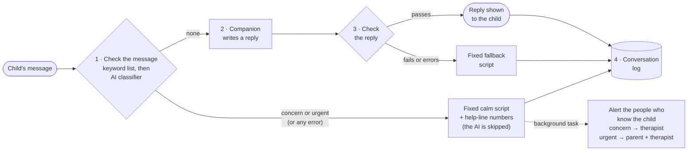

| Rule | What it means |
|---|---|
| **One door to the AI** | Only the provider layer (`app/ai/providers/`) may call an AI model. Nothing else can reach one. |
| **Fail closed** | If the classifier errors, times out or returns bad output, the message is treated as a **concern**. If the reply check fails, the child gets a fixed fallback script. An unchecked reply never reaches a child. |
| **No improvising in a crisis** | A flagged message never goes to the model. The child gets a fixed calm script and help-line numbers (for Australia: 000, Kids Helpline 1800 55 1800, Lifeline 13 11 14). |
| **Humans, not robots** | SafeGate never contacts emergency services itself. It alerts the people who know the child, in the background, so the child's reply is never slowed down. |
| **Nothing scary for the child** | Child-facing responses carry no risk level, score or classifier output. A flagged child is gently moved to calm steps and is never told why. |
| **A narrow companion** | The companion names emotions, walks through routines and runs calming exercises. It gives no medical advice, makes no promise of secrecy, and uses short, literal language with no sarcasm or idioms. |

The same defence layer checks journal entries and check-in notes before they are saved.

---

## 🔒 Privacy

- **Least access, enforced on the server.** A parent can reach only their own children, and a therapist only the children assigned to them. Both apps are thin: every rule is checked in the backend, never only in the interface.
- **Every access to a child's records is logged:** who, what and when, including access from the child's own device.
- **Separate tokens for children.** A child's device token can never reach an adult route, and an adult token can never act as a child. A parent can end a child's session on any phone at once.
- **Admins never read messages.** They see flagged-conversation metadata only, and they are deliberately refused a join token for live sessions.
- **Voice is never stored.** A child's recording goes to the speech-to-text provider and is then discarded. It is never written to disk or to the database.
- **Minimum data.** Optional emergency details are stored as empty rather than filled with placeholders, all times are stored in UTC, and the app uses no third-party analytics or trackers.
- **Private video rooms.** Rooms expire with the session, and only the child's own parent and assigned therapist can get a meeting token.

---

## 🧱 Architecture

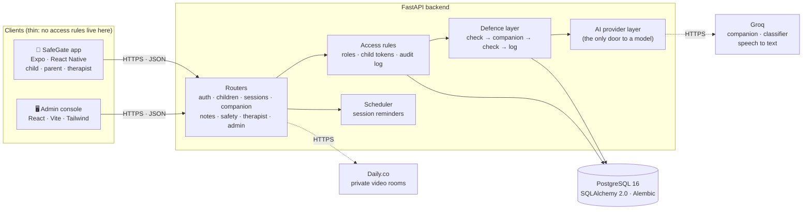

**How a child's message flows:** the app posts it to `/companion/reply` → the child's device token
is verified → the defence layer runs (check, companion, check) → the turn is saved → any alert is
queued as a background task → the child receives the reply or a calm script, with no risk
information in it.

---

## 🚀 Deployment

SafeGate runs in production on a cloud VPS. The API and its database run in Docker, and nginx on the
host handles HTTPS and routing.

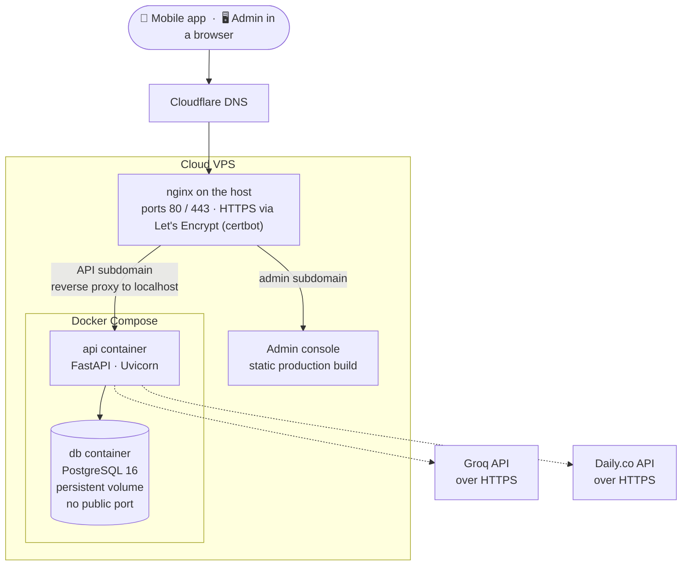

| Layer | Detail |
|---|---|
| **DNS** | Cloudflare points the admin and API subdomains at the server. |
| **Edge** | nginx on the host terminates HTTPS (certificates from Let's Encrypt via certbot), serves the admin console as static files, and reverse-proxies the API subdomain to the API container. |
| **API** | A FastAPI container that listens on the host's loopback interface only, so it is reachable only through nginx. Database migrations run when it starts. |
| **Database** | A PostgreSQL 16 container on a named Docker volume. It publishes no ports, so nothing outside the Docker network can reach it. |
| **Secrets** | Kept in a server-side `.env` that is never committed. Provider and model choices are changed live from the admin console, without a redeploy. |
| **Mobile** | The Expo app talks to the API subdomain over HTTPS. |

---

## 🧰 Tech stack

| Area | Technology |
|---|---|
| **Backend** | Python 3.12, FastAPI, Pydantic v2, SQLAlchemy 2.0 (async), Alembic, APScheduler |
| **Database** | PostgreSQL 16 |
| **AI** | Groq (`openai/gpt-oss-120b` for the companion and classifier, `whisper-large-v3-turbo` for speech to text), behind a provider layer with Google Gemini kept as a fallback |
| **Video** | Daily.co private rooms with short-lived, per-participant meeting tokens |
| **Mobile app** | Expo, React Native, expo-router, Zustand, SecureStore |
| **Admin console** | React 19, Vite, Tailwind CSS |
| **Infrastructure** | Docker Compose, nginx, Let's Encrypt, Cloudflare DNS |
| **Testing** | pytest against a real PostgreSQL, plus a 65-case safety suite run against the real model |

---

## 📁 Repository layout

```text
.
├── app/                    FastAPI backend
│   ├── ai/                 defence layer, provider layer, scripts and prompts
│   ├── db/                 SQLAlchemy models and sessions
│   ├── routers/            HTTP endpoints, one file per area
│   └── ...                 alerts, audit, scheduler, video, security, settings
├── alembic/                database migrations
├── frontend/               admin web console (React + Vite + Tailwind)
├── mobile/                 SafeGate app for child, parent and therapist (Expo)
│   └── HANDOFF.md          product rules and every screen, explained
├── tests/                  pytest suite and safety_cases.json
├── scripts/                demo seed data
├── docker/                 container entrypoint and proxy config
├── docs/images/            screenshots and figures used in this README
├── Dockerfile              backend image
├── docker-compose.yml      production stack
├── docker-compose.dev.yml  containerised local development
└── LICENSE                 all rights reserved
```

---

## 💻 Running it locally

> Running the code is permitted only for the evaluation described in the [`LICENSE`](LICENSE).

**Prerequisites:** Python 3.12, Node 20+, PostgreSQL 16.

```bash
# 1. Database (in psql)
CREATE USER autism_user WITH PASSWORD 'changeme';
CREATE DATABASE autism_support OWNER autism_user;

# 2. Backend
cp .env.example .env               # set JWT_SECRET_KEY; API keys are optional
python3.12 -m venv .venv && source .venv/bin/activate
pip install -r requirements.txt
python -m alembic upgrade head
python -m scripts.seed             # demo admin, therapist, parent and child; prints the password
python -m uvicorn app.main:app --port 8000      # API docs at http://localhost:8000/docs

# 3. Admin console
cd frontend && npm install && npm run dev       # http://localhost:5173

# 4. Mobile app
cd mobile && npm install && npx expo start      # scan the QR code with Expo Go, or press w for web
```

Without API keys the backend uses a **mock AI provider**, so everything works offline. Add a
`GROQ_API_KEY` (and optionally a `DAILY_API_KEY`) to `.env`, then choose the provider in the admin
console under **System → Settings**. A Linux host can use
`docker compose -f docker-compose.dev.yml up` instead of steps 1 and 2.

---

## 🧪 Testing

```bash
pytest                    # 243 tests against a real PostgreSQL, mock AI provider
pytest -m real_model -s   # 65-case safety accuracy report against the real model
```

The suite covers role access rules, double-booking prevention, fail-closed behaviour, child
device tokens, the separation between a parent seeing an alert and an admin clearing it, and that
admins can never reach message text.

**Safety accuracy report** (`openai/gpt-oss-120b`, all 65 cases):

| Risky messages caught | Safe messages wrongly flagged |
|:---:|:---:|
| **44 / 44** | **0 / 20** |

The cases cover clear risk, indirect risk, autism-specific distress (meltdown, shutdown) and harmless
messages that are easy to flag by mistake, such as "this homework is killing me" and "I beat the
final boss". This is a smoke test, not a clinical validation.

---

## 📍 Project status

SafeGate is a working prototype built for the Sydney IT Code Fair 2026. **It must not be used with
real children** until every item below is done:

- [ ] Clinical review of the safety scripts, keyword list and prompts (all marked `PLACEHOLDER`)
- [ ] Privacy law review (Australian Privacy Act and health-data rules)
- [ ] Confirming the AI and speech-to-text providers' data retention and training terms
- [ ] Encryption at rest, and a penetration test
- [ ] Real email and SMS delivery for alerts and reminders (mock today)
- [ ] A persistent job store for reminders (in-memory today)
- [ ] Terms of service stating the AI is not a monitoring or emergency service

---

## 👥 Team

SafeGate was designed and built by:

| | |
|---|---|
| **Suyog Kadariya** | [@suyogkad](https://github.com/suyogkad) |
| **Nasla Maharjan** | [@Naslaa](https://github.com/Naslaa) |
| **Krish Rajbhandari** | |

---

## 📜 Licence

**Copyright © 2026 Suyog Kadariya, Nasla Maharjan and Krish Rajbhandari. All rights reserved.**

This is proprietary software, published for viewing and for judging at the Sydney IT Code Fair 2026
only. You may not copy, reuse, modify, distribute, deploy, re-submit or train AI models on any part
of it without written permission from all three authors. The full terms are in [`LICENSE`](LICENSE).
